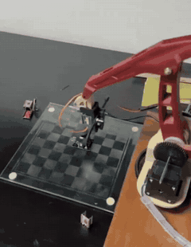
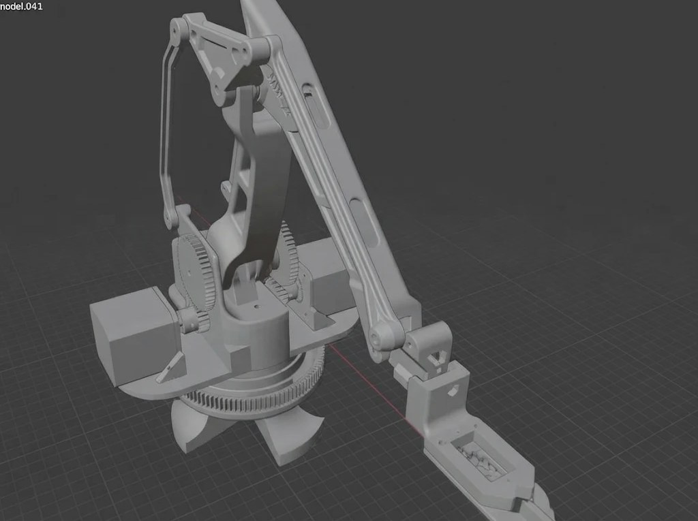
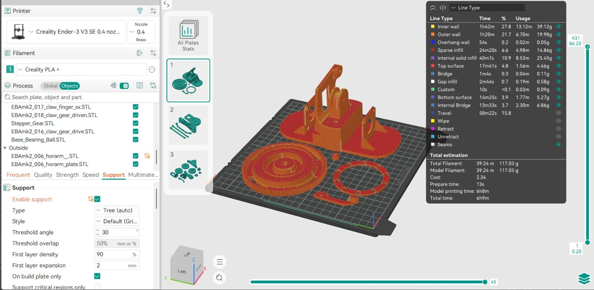

# Brazo robótico de 4 grados de libertad

Brazo robótico de *pick and place* diseñado en **Autodesk Inventor**, impreso en 3D (PLA, PrusaSlicer) y controlado desde una **Raspberry Pi** con tres motores paso a paso **NEMA 17**.

> Proyecto universitario — Universidad San Francisco de Quito (USFQ).

<p align="center">
  
  &nbsp;&nbsp;
  
</p>

[▶ Ver video en mejor calidad](docs/media/brazo_robotico.mp4)

## Cómo funciona

`move_to_point.py` lleva el efector final a un punto `(X, Y, Z)` en milímetros:

1. **Cinemática inversa:** `solve_ik(X, Y, Z)` entrega los ángulos de articulación `q1`, `q2` y `q3`.
2. **Mecanismo de barras:** el eslabón 2 se acciona mediante un paralelogramo articulado (L1 = 55, L2 = 130, L3 = 145, L4 = 55 mm). El ángulo del motor `θ1` que produce el ángulo `q3` deseado se obtiene resolviendo la ecuación de cierre del mecanismo con **SymPy** (`nsolve`), probando varias semillas dentro del rango −20° a 180°.
3. **Transmisión:** los ángulos de articulación se convierten a ángulo de motor con las relaciones de engranajes y luego a pasos (200 pasos/vuelta).
4. **Movimiento sincronizado:** los tres motores reciben sus pulsos en el mismo lazo, de modo que arrancan juntos.
5. El brazo espera 2 s en el punto objetivo y regresa a la posición inicial.

| Articulación | Motor | Relación de transmisión | STEP | DIR |
|---|---|---|---|---|
| Base (`q1`) | Motor 1 | 1 + 108/19 ≈ 6.68 | GPIO 25 | GPIO 24 |
| Eslabón 1 (`θ1`) | Motor 2 | 47/19 ≈ 2.47 | GPIO 17 | GPIO 27 |
| Eslabón 2 (`q2`) | Motor 3 (cableado invertido) | 47/19 ≈ 2.47 | GPIO 20 | GPIO 26 |

## Fabricación

Las piezas se imprimieron en 3D en una **Creality Ender-3 V3 SE** (boquilla de 0,4 mm) con **PLA**, con soportes tipo árbol. La placa mostrada pesa 117 g de filamento y se imprime en unas 6 h.

<p align="center">
  
</p>

## Estructura

| Archivo | Uso |
|---|---|
| `move_to_point.py` | Programa principal: cinemática inversa, mecanismo de barras y movimiento sincronizado al punto objetivo |
| `tools/stepper_test.py` | Prueba de un motor a la vez, para verificar cableado, pines y sentido de giro |
| `docs/media/` | Video, GIF, modelo CAD y laminado para impresión 3D |
| `IK.py` | Cinemática inversa (`solve_ik`) — *pendiente de subir* |

## Requisitos

- Raspberry Pi con Raspberry Pi OS (librería `lgpio`)
- 3 motores NEMA 17 con sus drivers (STEP/DIR)
- Python 3

```bash
pip install -r requirements.txt
```

## Uso

```bash
# 1. Verificar cada motor por separado
python tools/stepper_test.py

# 2. Mover el brazo a un punto (editar Xref_val, Yref_val, Zref_val en el archivo)
python move_to_point.py
```

## Tecnologías

Python · NumPy · SymPy · lgpio · Raspberry Pi · NEMA 17 · Autodesk Inventor · Impresión 3D (PLA)

## Autor

**Matías Loayza Correa** — Ingeniero Mecánico, USFQ  
[Portafolio](https://mleo22d.github.io) · [LinkedIn](https://www.linkedin.com/in/matias-loayza)
